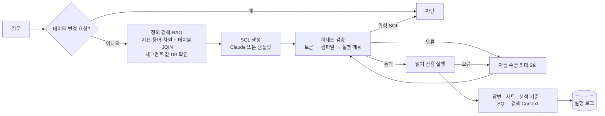

# Ajouney+ NL2SQL 에이전트

OTT 서비스 'AJOU사'의 고객 여정 대시보드 위에서, 마케터가 업무 용어로 질문하면 SQL을 만들어 답하는 에이전트입니다. 정의는 시맨틱 레이어에서 찾아 쓰고, 실행 전에는 하네스가 SQL을 검증합니다. 답변에는 숫자와 함께 계산 기준, 실행한 SQL, 검증 과정을 같이 보여 줍니다.

> 2026 해커톤 6팀 · 문제 1(고객 여정 대시보드) + 문제 2(시맨틱 레이어 기반 NL2SQL 에이전트)

- **대시보드 + 챗봇:** 대시보드가 화면 전체를 쓰고, 오른쪽 "AI 에이전트" 패널에서 질문합니다. 같은 패널의 "하네스 모니터링" 탭에서 모든 실행 기록을 봅니다.
- **서버 없음:** 고객 데이터를 브라우저 안의 SQLite(sql.js)에 올려 조회합니다. claude.ai 아티팩트로 배포합니다.
- **대시보드와 같은 숫자:** D+30 결제 전환율 24.9%, D+22~28 유지율 48.9%, 4주 지속 시청 고객 4,009명 등 대시보드·발표 자료의 숫자를 그대로 재현합니다(자동 테스트로 고정).

## 왜 이렇게 만들었나

마케터가 "20대 고객의 초기 미시청률은?"을 물을 때 필요한 것은 SQL 실력이 아니라 **팀이 합의한 지표 정의**입니다. 그리고 LLM이 만든 SQL을 그대로 실행하면 정의가 조금씩 달라지거나, 없는 컬럼을 쓰거나, 데이터를 바꾸는 SQL이 섞일 수 있습니다. 그래서 다음 두 가지를 축으로 삼았습니다.

1. **정의는 시맨틱 레이어에서:** 지표의 계산식, 분자·분모, 기간, 필터를 한곳(`data/`)에 정의하고, 질문과 관련된 정의만 검색해 LLM에 넘깁니다. 미리 저장해 둔 완성 쿼리는 쓰지 않고, 계산식·조건 조각을 질문에 맞게 조합해 SQL을 새로 만듭니다.
2. **실행은 하네스를 거쳐서:** 생성된 SQL은 실행 전에 3단계로 검사하고, 읽기 전용 연결에서만 실행합니다. 오류는 고쳐서 다시 시도하되, 위험한 SQL은 고치지 않고 차단합니다.

## 동작 방식



| 단계 | 하는 일 |
|---|---|
| 정의 검색 | BM25(한글 2-gram) + 별칭 일치 점수로 정의를 최대 6개 고르고, 의존 정의·테이블·JOIN 관계를 붙입니다. "20대" 같은 세그먼트는 DB의 실제 코드(`age_band = '20_29'`)로 확인합니다. |
| 데이터 가용성 | 원천 데이터가 없는 지표(예: 캠페인 반응률)는 숫자를 만들지 않고 필요한 데이터를 안내합니다. |
| SQL 생성 | 아래 "SQL은 누가 만드나" 참고 |
| 검증 | ① 토큰: 단일 문장, SELECT/WITH만, 위험 키워드·함수, SQLite 방언, 허용 테이블 ② SQLite 컴파일 ③ 실행 계획(바이트코드): 쓰기 연산, 실제로 읽는 테이블·컬럼, JOIN 조건, 타입 비교 |
| 실행 | `PRAGMA query_only` 연결, 최대 5,000행, 8초 제한, 실행 중 데이터 변경 감시 |
| 자동 수정 | 오류 유형(문법·없는 테이블·없는 컬럼·타입·JOIN·함수·시간 초과 등)과 메시지를 수정기에 넘겨 고친 뒤 재검증·재실행 |
| 로그 | 질문, 검색 순위·Context, 단계별 결과, 시도한 SQL, 수정 이유, 결과 미리보기(식별 키 마스킹)를 Request ID로 저장 |

### SQL은 누가 만드나

| 실행 위치 | SQL 생성 | API 키 |
|---|---|---|
| claude.ai 아티팩트 | **Claude** — 페이지를 연 사람의 claude.ai 계정으로 호출(아티팩트 `sample` 기능). 첫 호출 때 본인 허용을 받습니다. | 필요 없음 |
| 로컬 · 일반 웹 호스팅 | **템플릿 모드** — LLM 없이, 정의의 계산식·조건 조각에 질문의 그룹·필터를 규칙으로 조립 | 해당 없음 |

- 템플릿 모드는 Claude를 쓸 수 없을 때를 위한 대체 경로입니다. 정의된 지표의 단순 질문은 정확히 답합니다. 하지만 조인·정렬·상위 N·여러 조건이 필요한 질문은 "Claude가 생성해야 하는 질문"이라고 안내합니다.
- 답변 카드에 "Claude 생성"인지 "템플릿 모드"인지 표시하고, Claude 호출이 실패해 대체된 경우에는 이유와 "다시 시도" 버튼을 보여 줍니다.
- claude.ai 밖에서도 LLM으로 생성하려면 API 키를 둔 작은 서버(프록시)가 필요합니다. 키를 브라우저 코드에 넣으면 노출되기 때문입니다.

## 검증 결과

**대시보드 · 발표 자료 숫자 재현** (일부)

| 질문 | 결과 |
|---|---|
| D+30 결제 전환율 | 24.9% (50,000명 중 12,468명) |
| D+7 · D+14 · D+30 첫 결제 전환율 | 24.0% · 24.4% · 24.9% |
| 결제 후 시청 활성화율 D+7 · D+14 · D+28 | 79.4% · 82.8% · 85.6% |
| 초기 미시청률 | 20.6% (2,571명) |
| 초기 시청 실패 고객 / 푸시 도달 | 4,485명 (36.0%) / 1,655명 |
| 결제 후 D+22~28 시청 유지율 | 48.9% (6,103명) · 20대 43.9% · 60대 62.2% |
| 4주 지속 시청 고객 (퍼널 순차 기준) | 4,009명 |
| 고객 여정 퍼널 | 50,000 → 30,121 → 20,538 → 8,970 → 6,371 → 4,009 |
| VOD · 영화 · LIVE 이용률 | 79.6% · 37.3% · 7.8% |
| 우선 타깃 1위 (이용권 관심 후 미결제) / 푸시 도달 | 18,991명 / 8,152명 |

**하네스**

| 입력 | 처리 |
|---|---|
| `DELETE`, `SELECT 1; DROP TABLE …`, CTE 뒤에 숨긴 `INSERT`, `sqlite_master` 접근 | 실행 전 차단 · 수정 시도 없음 · 데이터 변경 0건 |
| 없는 컬럼, `COUNT(` 문법 오류, TEXT 컬럼에 숫자 비교 | 오류 감지 → 자동 수정 → 재실행 성공 |
| `COUNT(DISTINCT …)`, `IN (SELECT …)`, `replace()` 문자열 함수 | 정상 SQL로 통과 (오탐 방지) |
| 데이터 변경·삭제를 요청하는 질문 | LLM 호출 없이 차단 |
| 캠페인 반응률(발송 로그 없음) | 숫자를 만들지 않고 "추가 데이터 필요" |

`npm test`는 위 내용을 포함한 32개 테스트를 LLM 없이 실행합니다. 시맨틱 정의 63개의 SQL 조각이 모두 실제 DB에서 컴파일되는지, LLM에 넘기는 Context에 완성 SELECT 문이 없는지도 확인합니다.

## 폴더 구조

```
data/                       빌드 입력
  metadata.json               테이블·컬럼 메타데이터 (문제 2-1)
  semantic_layer.json         팀 시맨틱 레이어 원본 (문제 2-2)
  semantic_supplement.json    팀 원본에 없는 지표·용어 보충
  semantic_overrides.json     대시보드·발표 자료 숫자에 맞춘 보정
  csv/                        원천 CSV 7종 — 저장소에 없음, 직접 넣음
scripts/
  build-db.mjs                CSV → .build/ott.db (PK·FK 검증, 고객 여정 파생 테이블)
  semantic-adapter.mjs        팀 시맨틱 레이어 → 에이전트 정의 목록
  export-data.mjs             ott.db + 정의 → dist/data/*.js (브라우저용 데이터)
  build.mjs                   web/ + dist/data → dist/
  serve.mjs                   로컬 확인용 정적 서버
web/
  index.html · css/app.css    화면 틀 · 디자인 토큰(라이트/다크)
  dashboard.html              팀 대시보드 — 저장소에 없음, 직접 넣음
  js/engine/                  core.js(DB·검증·실행) → rag.js(정의·검색) → agent.js(생성·하네스·로그)
  js/ui/                      common.js → chat.js(챗봇) → monitor.js(하네스 모니터링) → main.js(시작)
  vendor/                     sql.js 1.13.0 (wasm + asm.js 대체 빌드, MIT)
tests/                        엔진을 Node 에서 돌리는 회귀 테스트
```

## 실행

Node.js 22.5 이상이 필요합니다(`node:sqlite`). 외부 npm 패키지는 쓰지 않습니다.

먼저 저장소에 없는 입력 두 가지를 넣습니다. 둘 다 고객 단위 데이터라 git에서 제외했습니다.
- `data/csv/`: 원천 CSV 7종 (`user_dim`, `payment_fact`, `behavior_fact`, `watch_daily_fact`, `user_content_summary`, `content_dim`, `content_genre_bridge`)
- `web/dashboard.html`: 팀 대시보드 HTML. 없으면 에이전트 패널만 동작합니다.

```bash
npm run build:db      # data/csv → .build/ott.db
npm run build:data    # .build/ott.db → dist/data/*.js
npm run build         # dist/ 조립
npm run serve         # http://localhost:8765/local.html (템플릿 모드)
npm test              # 회귀 테스트 32개
```

**claude.ai 아티팩트로 배포**
- `dist/index.html`을 페이지로 게시하고, 나머지 `dist/` 파일(`js/`, `vendor/`, `data/`, `dashboard.html`)을 같은 경로로 함께 게시합니다.
- `sample`(Claude 호출), `db`(공유 로그), `downloads`(로그·테스트 결과 저장) 기능을 선언합니다.
- 아티팩트는 외부 CDN에서 스크립트 외 파일을 막으므로 sql.js의 `.wasm`도 같이 게시합니다. WebAssembly가 막힌 환경에서는 `sql-asm.js`로 자동 대체합니다.

## 데이터와 개인정보

- **저장소에서 제외한 것:** 원천 CSV, 생성된 DB와 `dist/`, 팀 대시보드 HTML(고객 키 내장)은 모두 고객 단위 데이터라 저장소에 올리지 않습니다.
- **원천 데이터:** 해커톤 주최 측이 제공한 가명 처리 데이터입니다. 날짜는 365일 이동돼 있고, 고객 키는 64자 해시입니다.
- **로그:** 결과 미리보기에서 `user_key`·`payment_key` 값을 마스킹합니다. 공유 로그는 아티팩트에 접근 권한이 있는 사람이 볼 수 있습니다.
- **Claude 사용량:** 아티팩트에서 Claude 호출은 질문한 사람 본인의 claude.ai 사용량으로 처리됩니다.

## 한계와 다음 단계

- **Claude 호출:** claude.ai에서 `upstream_error`로 간헐적으로 실패합니다. 실패하면 템플릿 모드로 대체하고, 패널의 "Claude 연결 확인"으로 어느 단계에서 실패하는지 가릴 수 있습니다.
- **세그먼트 인식:** 검색된 차원 정의 안에서만 세그먼트 값을 확인합니다. 그래서 "20대 iOS"처럼 차원이 둘인 질문에서 하나가 빠질 수 있습니다. 모든 차원의 값 목록과 대조하도록 개선할 예정입니다.
- **후속 질문:** 이전 대화를 이어받지 않아 "그럼 30대는?"을 독립 질문으로 처리합니다.
- **기준이 여러 개인 지표:** "지속 시청 고객"처럼 기준이 여럿인 지표(5,088 · 5,967 · 4,009명)는 하나를 골라 답하고, 다른 기준은 주의 문구로만 알립니다.
- **쿼리 중단 불가:** SQL은 화면과 같은 스레드에서 실행됩니다. 첫 행이 나오기 전에 오래 걸리는 쿼리는 중간에 멈출 수 없어, Web Worker로 옮기는 것이 다음 과제입니다.
- **팀 원본 정의 문서 누락:** 팀 원본 시맨틱 레이어의 정의 13개에 설명·기간·단위 등 문서 필드가 비어 있습니다(`tests/agent.test.cjs`의 `KNOWN_DOC_GAPS`).
- **행동 로그 미적재:** 행동 로그(`behavior_fact`, 45만 행)는 브라우저에 올리지 않습니다. 행동 지표는 고객 여정 테이블의 파생 컬럼으로만 답합니다.

## 라이선스 · 출처

- sql.js 1.13.0: MIT (`web/vendor/sql.js-LICENSE`)
- 데이터: 2026 해커톤 제공 데이터 (저장소 미포함)
